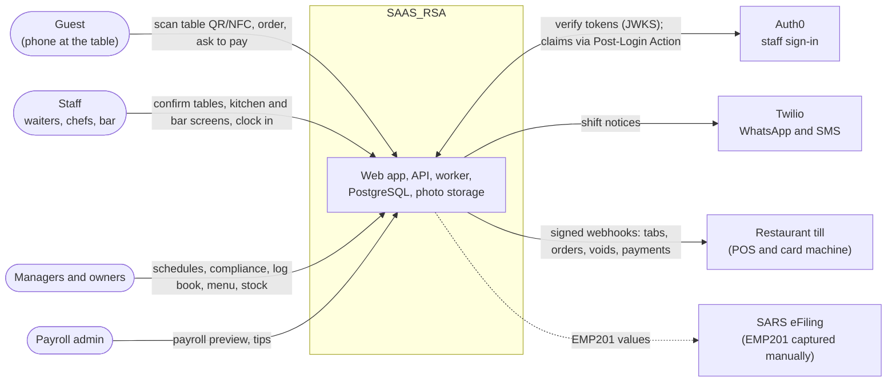
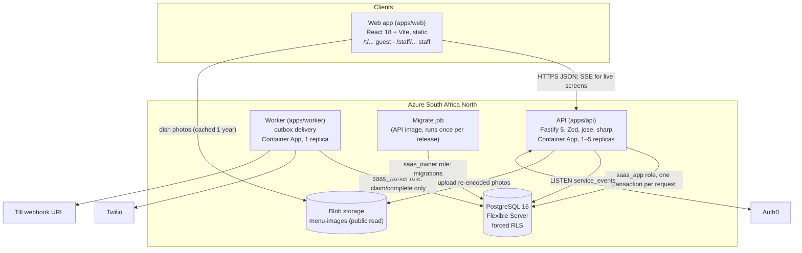
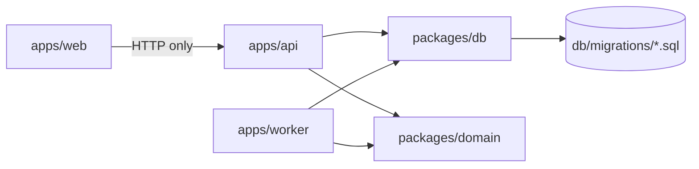
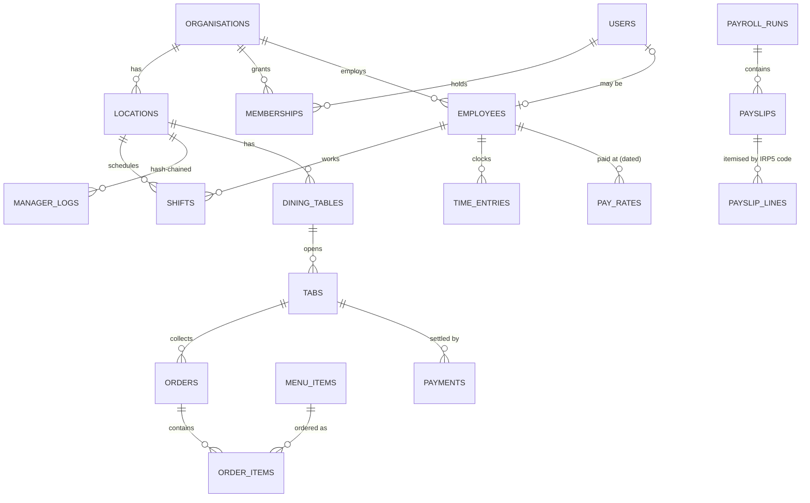
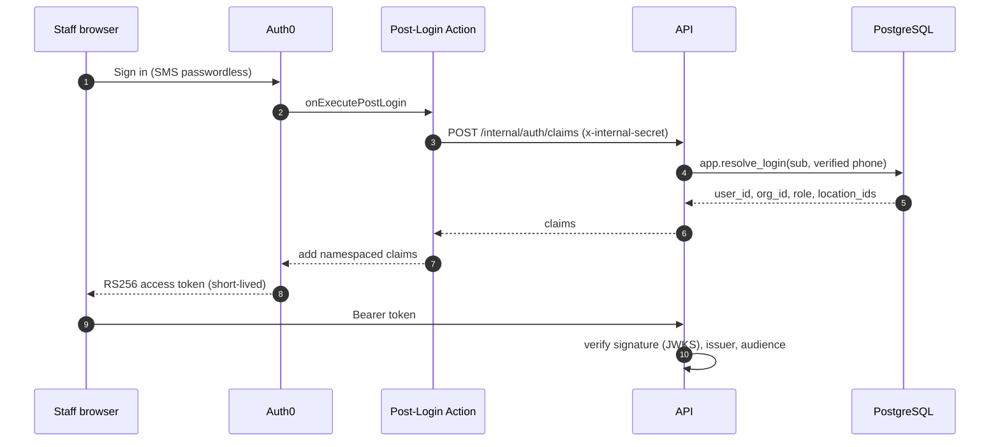
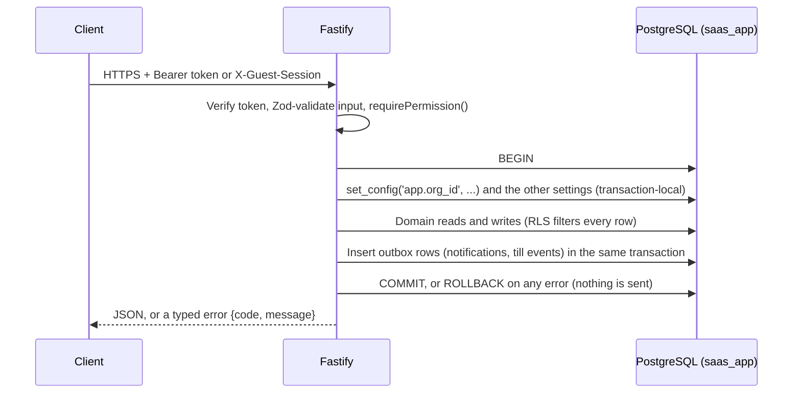
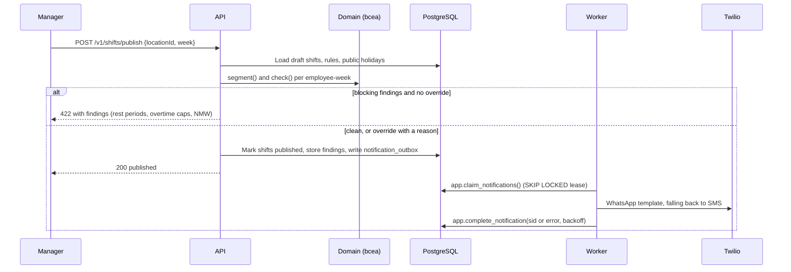
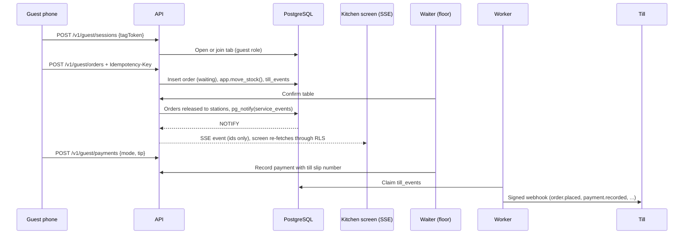
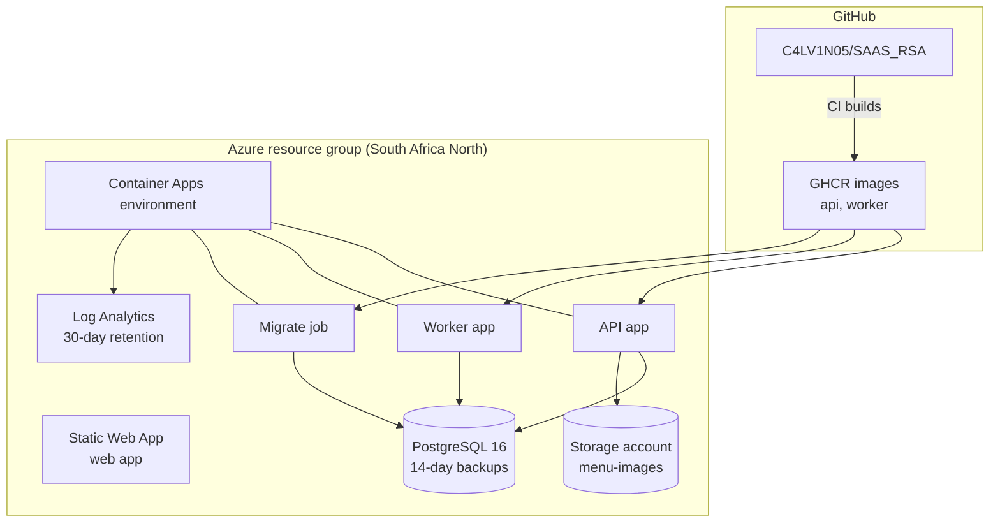
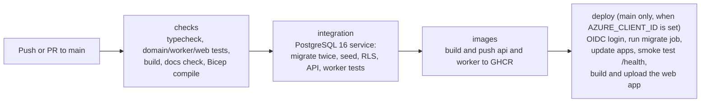

# Architecture

SAAS_RSA is a multi-tenant platform for South African restaurants and hospitality groups. It covers four pillars:

- **Schedule:** scheduling, time clocking and labour compliance.
- **Pay:** payroll and tip management.
- **Retain:** the manager log book.
- **Serve:** table ordering that works alongside the restaurant's existing till.

This document describes the whole system as built: its parts, how data and requests flow through them, how tenants are kept apart, how it is deployed, and what is still to come. It is kept in the repository and checked by CI (`pnpm docs:check`), so it changes with the code.

Related documents:

- `docs/SERVE.md`: the table-ordering flow, guest API and till webhook contract.
- `docs/DEPLOY_AZURE.md`: one-time Azure, Auth0 and Twilio setup.
- `docs/BLUEPRINT.md`: the original blueprint that this design revised.

## Contents

1. [Principles](#1-principles)
2. [System context](#2-system-context)
3. [Containers](#3-containers)
4. [Code structure](#4-code-structure)
5. [Modules by pillar](#5-modules-by-pillar)
6. [Data architecture](#6-data-architecture)
7. [Security and privacy](#7-security-and-privacy)
8. [Key flows](#8-key-flows)
9. [Background work and integrations](#9-background-work-and-integrations)
10. [Deployment](#10-deployment)
11. [Build and release](#11-build-and-release)
12. [Testing](#12-testing)
13. [Operations](#13-operations)
14. [Decision record](#14-decision-record)
15. [Assumptions awaiting sign-off](#15-assumptions-awaiting-sign-off)
16. [Roadmap](#16-roadmap)

## 1. Principles

These choices shape everything below:

- **South African law is data, not code.** Rates, ceilings, tax tables and limits are dated rule versions. A payslip records the versions it used, so a March 2027 change never rewrites a February payslip.
- **The database is the last line of defence.** Every tenant table uses forced row-level security (RLS), and the API connects as a role that cannot bypass it. An API bug cannot show one restaurant another's staff, pay or orders.
- **Money is integer cents.** Splits use largest-remainder allocation, so totals always add up to the cent.
- **History is never edited.** Finalised payroll is locked by trigger. Log book entries change only through new revisions on a hash chain. Stock moves through an append-only ledger.
- **Built for load-shedding and prepaid data.** Clock-ins and orders can be retried safely (idempotency keys). Guest pages are small, with fonts bundled. Live screens reconnect on their own.
- **Data stays in South Africa.** The database, API, worker and photos run in Azure South Africa North, and backups replicate to South Africa West.
- **Few moving parts.** PostgreSQL carries queues (outboxes) and live events (`LISTEN/NOTIFY`). There is no Redis or message broker to run.

## 2. System context

| Actor or system | Relationship |
| --- | --- |
| Guests | Have no account. A table's QR or NFC tag opens a guest session limited to that table's tab. |
| Staff and managers | Sign in through Auth0. Their role and locations come from their membership in the organisation. |
| Auth0 | Issues RS256 access tokens. A Post-Login Action asks the API for the user's tenant claims. |
| Twilio | Delivers notifications: WhatsApp templates first, SMS as the fallback. |
| Till | Stays the system of record for payment. SAAS_RSA pushes every tab event to it and records the till slip number. |
| SARS | EMP201 is captured on eFiling, so the system produces the values rather than a file. |

## 3. Containers

| Container | Technology | Responsibility |
| --- | --- | --- |
| Web app | React 18.3, React Router 6, Vite 6; Auth0 SPA SDK; fonts bundled with `@fontsource` | Guest ordering at `/t/<tag>` and `/tip/<code>`. Staff screens under `/staff` (see [Screens](#screens)). Each screen is its own chunk, so guests download about 60 KB of script. |
| API | Node 22, Fastify 5, Zod, Drizzle on node-postgres, jose, sharp, Azure Blob SDK | REST API. Authenticates, applies RBAC, opens a tenant-scoped transaction, runs domain logic, writes outbox rows in the same transaction. Streams live service events over SSE. |
| Worker | Node 22, node-postgres, Twilio REST | Claims rows from the two outboxes and delivers them: notifications to Twilio and till events to the till's webhook URL, with retries and backoff. |
| PostgreSQL | Azure Flexible Server 16 | System of record. Enforces tenancy (RLS), immutability (triggers), stock rules (`app.move_stock`) and queueing (`SKIP LOCKED` leases). |
| Blob storage | Azure Storage, `menu-images` container | Re-encoded dish photos, public read, immutable caching. |
| Migrate job | Container Apps job on the API image | Runs `db/migrations` in order as `saas_owner`, then sets the passwords for the two login roles. |

## 4. Code structure

The code is a pnpm monorepo. Dependencies point one way: apps depend on packages, and `packages/domain` depends on nothing.

| Path | Contents |
| --- | --- |
| `packages/domain` | Pure TypeScript with no I/O. BCEA segmentation and checks (`bcea/`), SA payroll (`payroll/`), tip distribution (`tips/`), log book hash chain (`logbook/`), dated rules (`rules/`), Serve bill splitting, stock and tip routing (`serve/`), money and time helpers. Fully unit-tested. |
| `packages/db` | Drizzle schema (`src/schema.ts`), migration runner (`src/migrate.ts`), seed (`src/seed.ts`), and `withTenant()`, which opens a transaction and sets the tenant context (`src/tenant.ts`). |
| `db/migrations` | The SQL source of truth: tables, RLS policies, SECURITY DEFINER functions, triggers. Forward-only and numbered. |
| `apps/api` | Fastify app (`src/app.ts`), auth (`src/auth.ts`), permissions (`src/permissions.ts`), routes per module (`src/routes/`), media pipeline (`src/media.ts`), live events (`src/events.ts`). |
| `apps/worker` | Outbox loop (`src/outbox.ts`), Twilio providers (`src/providers.ts`, `src/deliver.ts`), till webhooks (`src/till.ts`). |
| `apps/web` | Guest pages (`src/guest/`), staff pages (`src/staff/`, with role access in `src/staff/access.ts`), shared API, auth, SSE, SAST date and offline clock-queue helpers (`src/lib/`). |
| `infra/azure` | `main.bicep`: every Azure resource. |
| `infra/auth0` | `post-login-action.js`: adds tenant claims to access tokens. |

## 5. Modules by pillar

### Schedule

| Module | What it does | Data | API | Domain |
| --- | --- | --- | --- | --- |
| Scheduling | Draft shifts, then publish. Publishing runs the BCEA checks on the proposed week and refuses on blocking findings unless a manager overrides with a reason; a dry run shows the findings first. Drafts can be edited or deleted; published shifts are cancelled, never deleted. Published shifts trigger WhatsApp/SMS notices. | `job_roles`, `employees`, `shifts`, `rotation_patterns` | `POST/GET /v1/shifts`, `PATCH/DELETE /v1/shifts/:id`, `POST /v1/shifts/publish` (`dryRun`), `GET /v1/team` | `bcea/` |
| Time clocking | Clock in and out, with breaks, from a phone or kiosk. Every action carries an `Idempotency-Key`, so retries after a dropped connection never create duplicates. With no signal, the phone keeps the action with its real time and sends it later (accepted up to 72 hours). Mobile clock-ins outside the location's geofence are flagged, not refused. Managers see late starts, overruns, offline and edited entries, then approve or correct them with a reason. | `time_entries`, `time_entry_breaks` | `POST /v1/time/clock-in`, `/clock-out`, `/:id/breaks`, `/:id/approve`, `PATCH /v1/time/:id`, `GET /v1/time`, `GET /v1/me`, `POST /v1/me/break` | `time.ts`, `apps/web/src/lib/clockQueue.ts` |
| Labour compliance | Splits worked minutes into ordinary, overtime, Sunday, public holiday and night segments, then checks them against BCEA limits: 9 h/8 h daily and 45 h weekly ordinary time, overtime caps and agreement, 12 h daily and 36 h weekly rest, meal intervals, and the national minimum wage. | `compliance_findings`, `public_holidays`, `rule_versions` | `POST /v1/compliance/employee-week` | `bcea/segment.ts`, `bcea/checks.ts` |

### Pay

| Module | What it does | Data | API | Domain |
| --- | --- | --- | --- | --- |
| Payroll | Calculates payslips from approved hours and dated pay rates: earnings by segment, PAYE (annualised), UIF (ceiling pro-rated to the pay period), SDL, ETI, and medical credits. Each line carries its IRP5 source code. Produces EMP201 totals. Finalised runs are locked by trigger. | `pay_rates`, `pay_periods`, `payroll_runs`, `payslips`, `payslip_lines`, `leave_transactions` | `POST /v1/payroll/preview` | `payroll/payslip.ts`, `payroll/statutory.ts` |
| Tip management | Declares shift tips and distributes them by hours with a front-of-house/back-of-house split, to the cent. Tips are excluded from the minimum wage test and flagged for tax review. Serve card tips go to the tip-code waiter, else the assigned waiter, else the pool. | `tip_pools`, `shift_tips`, `tip_distributions`, `tip_codes` | `GET/POST /v1/tips/pools`, `GET /v1/tips`, `POST /v1/tips/declare`, `/distribute` | `tips/distribute.ts`, `serve/tips.ts` |

### Retain

| Module | What it does | Data | API | Domain |
| --- | --- | --- | --- | --- |
| Manager log book | Shift notes by category. Entries are never updated: a correction is a new revision. Each location's entries form a SHA-256 hash chain that anyone can verify. Staff acknowledge entries they have read; the list shows who wrote each entry, its corrections, and read receipts. | `manager_logs`, `log_acknowledgements`, `performance_tracking` | `POST/GET /v1/logbook`, `/:group/revisions`, `/entries/:id/ack`, `GET /v1/logbook/verify` | `logbook/hashchain.ts` |

### Serve

Full detail is in `docs/SERVE.md`.

| Module | What it does | Data | API |
| --- | --- | --- | --- |
| Menu and photos | Categories and dishes with VAT-inclusive prices, kitchen or bar station, till code, and stock components. Managers upload dish photos, which are re-encoded to 640 px and 320 px WebP with metadata removed. | `menu_categories`, `menu_items`, `menu_item_components` | `GET /v1/menu`, `/v1/menu/items/...`, `POST/DELETE /v1/menu/items/:id/image` |
| Tables and sessions | Each table has a tag (QR or NFC). Scanning it opens or joins the table's tab as a guest session. The assigned waiter confirms the table before orders go to the kitchen. | `dining_tables`, `table_tags`, `table_assignments`, `tabs`, `guest_sessions` | `POST /v1/guest/sessions`, staff floor routes |
| Orders and stations | Orders route by station to the kitchen or bar screens, which update live. Items move from preparing to ready to served. Only managers void, and voids return stock. | `orders`, `order_items` | `POST /v1/guest/orders`, `/v1/stations/:station/queue`, `/stream` |
| Stock | Each order deducts its components in the same transaction. Dishes show as sold out when stock runs short. Deliveries, stock-takes and waste are recorded. | `inventory_items`, `inventory_movements` | inventory routes |
| Bills and payment | Split by own items, the remainder, or equal shares. Payment is taken on the till's card machine and recorded with the till slip number. | `payments`, `payment_allocations` | `POST/GET /v1/guest/payments`, floor routes |
| Till sync | Every tab, order, void and payment is written to an outbox and delivered to the till as a signed webhook. | `till_integrations`, `till_events` | `PUT /v1/till-integration` |

### Screens

All staff screens live under `/staff` in the web app. The menu shows each person only the screens their role can use (`apps/web/src/staff/access.ts` mirrors the API permissions); the API and RLS still enforce them.

| Screen | Path | Roles | What it does |
| --- | --- | --- | --- |
| My shifts | `/staff/me` | Everyone with an employee record | Clock in and out (with location), breaks, upcoming shifts, last 7 days. Works without signal. |
| Floor | `/staff/floor` | Managers, staff | Confirm new tables, payment requests, close tables paid at the till. |
| Kitchen, Bar | `/staff/station/:station` | Managers, staff | Live docket rail per station. |
| Menu | `/staff/menu` | Owner, general manager | Dish photos and availability. |
| Schedule | `/staff/schedule` | Owner, general and shift managers | Week roster with hours and wage cost, draft and edit shifts, check against the BCEA and publish (general managers and owners). |
| Timesheets | `/staff/timesheets` | Managers, payroll admin | Week of clock entries with flags; correct with a reason; approve. |
| Tips | `/staff/tips` | Managers, payroll admin | Record a day's tips, choose the sharing rule, preview and record each share. |
| Log book | `/staff/logbook` | Managers | Write, correct, mark as read, and check the hash chain. |
| Payroll | `/staff/payroll` | Owner, payroll admin | Preview payslips and EMP201 values for a period. |

## 6. Data architecture

### Tenancy model

- An **organisation** is the legal employer, with its own PAYE reference. It owns one or more **locations**.
- A **user** is a person who signs in. Users join organisations through **memberships**, which carry a role and the locations the user can see. One person can work for two organisations without their data meeting.
- An **employee** is the payroll record. It may be linked to a user, but does not have to be: a kitchen porter without a smartphone can still be scheduled and paid.
- Every tenant table carries `org_id`. Location-scoped tables also carry `location_id`.

### Conventions

| Concern | Convention |
| --- | --- |
| Money | `bigint` cents. Rates in basis points (`vat.rate_bp` = 1500). Allocation by largest remainder. |
| Time | `timestamptz` in UTC. Business dates are computed in `Africa/Johannesburg`. BCEA weeks run Monday to Sunday. |
| Rules | `rule_versions(key, effective_from, value, org_id null or set)`. An org override beats the national default. Seeded each year by `packages/db/src/seed.ts`. |
| Identifiers | UUIDs everywhere. Guest and tag tokens are 24 random bytes, base64url. |
| Sensitive numbers | ID, tax and bank numbers have `bytea` columns reserved for field-level encryption (not yet switched on). |
| Photos | Content-addressed keys `{org}/{item}/{hash}-{640,320}.webp`. |

### Immutability and audit

| What | How it is protected |
| --- | --- |
| Finalised payroll | A trigger rejects updates and deletes on finalised runs and their payslips and lines. |
| Log book | Insert-only. Each row stores the hash of the previous row in its location. `GET /v1/logbook/verify` recomputes the chain. |
| Stock | `inventory_movements` is an append-only ledger. `app.move_stock` locks items in a fixed order and refuses to go below zero. |
| Payslip rules | Each payslip stores the rule versions it used. |
| Changes generally | `audit_log` records who changed what. |

### Database roles

| Role | Used by | Can do |
| --- | --- | --- |
| `saas_owner` | Migrate job only | Owns the tables and runs migrations. |
| `saas_app` | API | Reads and writes tenant tables. RLS always applies (`FORCE ROW LEVEL SECURITY`). |
| `saas_worker` | Worker | Only `app.claim_notifications`, `app.complete_notification` and the till-event equivalents. It cannot read tenant tables. |

## 7. Security and privacy

### Authentication

- On first sign-in, `app.resolve_login` links the Auth0 account to the invited user by verified phone number.
- Claims are namespaced under `https://saas-rsa.app/`.
- In local development without Auth0, the API accepts HS256 tokens signed with `AUTH_DEV_SECRET`. In production, start-up fails without the Auth0 JWKS settings, and once they are set the dev secret is never used.
- Guests do not authenticate. A table tag creates a guest session token (6 hours, or until the tab closes), sent in `X-Guest-Session`.

### Authorisation: twice, on purpose

1. **At the edge:** `requirePermission()` checks the role's permissions (`apps/api/src/permissions.ts`) and returns a clear 403.
2. **In the database:** every request runs inside `withTenant()`, which sets `app.org_id`, `app.user_id`, `app.role`, `app.location_ids` and, for guests, `app.tab_id` for that transaction only. Policies then apply:
   - a permissive tenant policy (`org_id = app.org_id`);
   - restrictive policies for location, role and "own rows only" (employees see their own pay);
   - restrictive guest policies that limit guests to their own tab and deny every staff table.

| Role | Main permissions |
| --- | --- |
| `owner` | Everything, including till configuration. |
| `general_manager` | Schedule and publish, approve time, compliance and overrides, tips, log book, run service, void, manage the menu and stock. |
| `shift_manager` | Schedule (not publish), approve time, tips, log book, run service, void. |
| `payroll_admin` | Read schedules, approve time, compliance, payroll, tips. |
| `employee` | Read own schedule, clock in and out, run service. |
| `kiosk_device` | Clock in and out only. |

SECURITY DEFINER functions (tag lookup, guest session lookup, login resolution) switch to a `system` role through `app.enter_system()` and restore the caller's settings with `app.leave_system()`.

### Privacy (POPIA) and data protection

- **Residency:** the database, API, worker, photos and logs are in South Africa North, with geo-backups to South Africa West. The Static Web App serves only static files; its resource metadata sits in West Europe.
- **Minimisation:** guests are anonymous. Dish photos are re-encoded, which removes camera metadata and GPS location. Originals are not kept.
- **Biometrics:** face verification at clock-in is deliberately not built until a vendor, liveness detection and explicit consent are agreed.
- **Secrets:** stored as Container Apps secrets, set by Bicep from deployment parameters. CI uses OIDC, so no Azure credentials are stored in GitHub.
- **Transport:** HTTPS only. Postgres requires TLS (`sslmode=require`). Storage enforces TLS 1.2.
- **Webhooks:** till events are signed with HMAC-SHA256 over the timestamp and body. Receivers dedupe on the delivery id.

## 8. Key flows

### A request, end to end

### Publishing a schedule

### Serve: from scan to till

## 9. Background work and integrations

| Outbox | Written by | Delivered to | Retry |
| --- | --- | --- | --- |
| `notification_outbox` | Publishing, schedule changes | Twilio: WhatsApp Content template (ContentSid and variables), SMS fallback | Leased claim with `SKIP LOCKED`, exponential backoff, 6 attempts |
| `till_events` | Every tab, order, void and payment change | The till's webhook URL, signed | Exponential backoff, 8 attempts, same delivery id on each retry |

Live screens use PostgreSQL rather than a broker. A trigger on `order_items` calls `pg_notify('service_events', ...)`. Each API replica holds one `LISTEN` connection and fans events out to its SSE clients. Events carry only ids, so each screen re-fetches through RLS and never sees another tenant's data. Screens also poll every 30 seconds as a fallback.

The media pipeline works like this:

1. The client shrinks large photos to 1600 px.
2. The API receives the raw body (8 MB limit) and decodes it with sharp.
3. sharp turns it upright and crops it to a square around the area of interest.
4. Two WebP copies are encoded and stored under content-hash keys with `Cache-Control: immutable`.

## 10. Deployment

Every resource is declared in `infra/azure/main.bicep`. The main parameters are the name prefix, Postgres SKU, database passwords, Auth0 domain and audience, and the Twilio settings.

| Resource | Setting |
| --- | --- |
| PostgreSQL Flexible Server | Burstable B1ms to start. 14-day backups. Optional geo-redundant backup to South Africa West. |
| API Container App | 0.5 vCPU, 1 GiB. 1–5 replicas, scaling at 50 concurrent requests. Liveness and readiness probes on `/health`. |
| Worker Container App | One replica. Polls the outboxes every 2 seconds. |
| Storage | Standard LRS. Public blob read on `menu-images` only. TLS 1.2. |
| Static Web App | Serves `apps/web/dist`. The API allows its origin through CORS. |

## 11. Build and release

- Branch protection on `main` requires the `checks` and `integration` jobs to pass.
- Migrations run twice in CI to prove the runner is idempotent.
- Releases are immutable: images are tagged with the commit SHA.
- Database changes are forward-only. A release that needs a change ships the migration first, and the migrate job runs before the apps update.

## 12. Testing

| Layer | What is tested | Where |
| --- | --- | --- |
| Domain | BCEA segmentation and checks, PAYE/UIF/SDL/ETI against SARS tables, tip splits to the cent, hash chain, bill splitting, stock | `packages/domain/test` |
| Database | Tenant isolation as `saas_app`: cross-org reads return nothing, cross-org writes are refused, guest limits | `packages/db/test` |
| API | End to end over HTTP against a real database: auth and claims, RBAC, publish gate and dry run, clocking idempotency and breaks, team and timesheet views, tip pools, log book chain and read receipts, Serve flow, photo upload and processing | `apps/api/test` |
| Worker | Twilio adapters and fallback, outbox claiming as `saas_worker`, till signing | `apps/worker/test` |
| Web | Bill choices, tip maths, SSE parsing, SAST dates, schedule costing, timesheet flags, pay periods, offline clock queue, screen access | `apps/web/test` |
| Docs | Every file path named in this document exists | `scripts/check-docs.mjs` |

## 13. Operations

- **Migrations:** run `pnpm db:migrate` locally. In Azure, the migrate job runs on every release, and the runner records applied files.
- **Annual maintenance:** each February, add the new tax year's tables and the March minimum wage as new rule versions in `packages/domain/src/rules/sa-defaults.ts`, then re-run the seed. Public holidays are seeded per year.
- **Logs:** Container Apps send stdout to Log Analytics (30 days). The API logs as JSON through Fastify's logger.
- **Health:** `GET /health` is used by the probes and the deploy smoke test.
- **Backups:** Postgres point-in-time restore for 14 days. Photos can be re-uploaded, and their keys are deterministic.

## 14. Decision record

| # | Decision | Why | Where |
| --- | --- | --- | --- |
| 1 | Membership-based tenancy with forced RLS, instead of `tenant_id = auth.uid()` | An owner may run several restaurants, and staff may work for two employers | `0001_core.sql`, `0005_rls.sql`, `packages/db/src/tenant.ts` |
| 2 | Organisation (legal employer) above locations | PAYE, UIF and SDL are registered per employer, not per branch | `0001_core.sql` |
| 3 | Dated rule versions instead of hardcoded R30.23, R17,712 and 45 h | Rates change every March, and old payslips must stay reproducible | `packages/domain/src/rules/` |
| 4 | UIF ceiling pro-rated to weekly and fortnightly periods | The monthly ceiling over-deducts on shorter periods | `packages/domain/src/payroll/statutory.ts` |
| 5 | Dated `pay_rates` | Raises mid-period must price hours correctly | `0002_schedule.sql` |
| 6 | Runs, payslips and coded lines instead of fixed columns | IRP5 and EMP501 need source codes, and new earnings types need no schema change | `0003_pay.sql`, `payroll/payslip.ts` |
| 7 | Minimum wage tested per hour worked, tips excluded | That is how the National Minimum Wage Act measures it | `bcea/checks.ts` |
| 8 | Integer cents | No floating-point rounding in pay or bills | `money.ts` |
| 9 | Transactional outbox, with Postgres as the queue | A rolled-back publish must send nothing, and there is no broker to run | `0006_auth_and_outbox.sql`, `apps/worker` |
| 10 | No Redis | Azure Cache for Redis is closed to new customers. `LISTEN/NOTIFY` and `SKIP LOCKED` cover current needs | `apps/api/src/events.ts` |
| 11 | Auth0 with a claims endpoint | Managed SMS passwordless sign-in, with tenant claims that stay authoritative in our database | `routes/internal-auth.ts`, `infra/auth0/` |
| 12 | Serve works alongside the till | Restaurants keep their card machines and POS, which lowers switching cost | `0007_serve.sql`, `docs/SERVE.md` |
| 13 | Guests as a database role | Guest pages are public, so isolation must not depend on API code | `0007_serve.sql` |
| 14 | Photos re-encoded and content-addressed | Strips location data (POPIA), keeps pages light, and allows permanent caching | `apps/api/src/media.ts` |
| 15 | Self-hosted fonts, staff code split out | Prepaid data costs, and no Google Fonts call | `apps/web/src/main.tsx` |
| 16 | Azure South Africa North | Data residency, latency, and in-region backups | `infra/azure/main.bicep` |

## 15. Assumptions awaiting sign-off

For a labour lawyer:

- The daily ordinary limit applies to the date a shift starts. Minutes after midnight are priced on the new date.
- Sunday and public holiday minutes count toward the ordinary limits. Overtime on those days takes the higher multiplier.
- Employees above the BCEA earnings threshold get no overtime or Sunday premium, but keep public holiday double pay.
- Weeks run Monday to Sunday.

For a registered tax practitioner:

- PAYE uses the annualise-the-period method. Irregular income (bonuses, leave payouts) needs the year-to-date method, which is not yet built.
- Tips paid through payroll are taxed as remuneration (IRP5 3601) and excluded from the UIF base. These lines are flagged `needsReview`.
- ETI follows the 1 April 2025 table. Weekly and fortnightly payrolls need month-end ETI aggregation.
- Serve card tips paid with the bill are recorded as card tips to the waiter and flow through payroll. Confirm the treatment where tips go straight to a waiter's own account.

## 16. Roadmap

Waiting on a decision from the business:

- Face verification at clock-in: vendor, liveness detection, and POPIA biometric consent.
- Online card payment in the guest app (a hosted checkout such as Yoco, Peach Payments or Paystack).
- Adapters for specific till vendors.

Ready to build:

- Persisted payroll runs (draft, approved, finalised, paid), payslip PDFs and EFT bank files.
- EMP501 and IRP5 export (e@syFile), and Xero/Sage journals.
- Leave accrual and payouts (the ledger table exists), terminations and UI-19.
- Rotation pattern expansion into shifts.
- Field-level encryption for ID, tax and bank numbers.
- Twilio delivery status callbacks (the outbox already stores the message SID).
- Real-time manager alerts on the same SSE channel.
